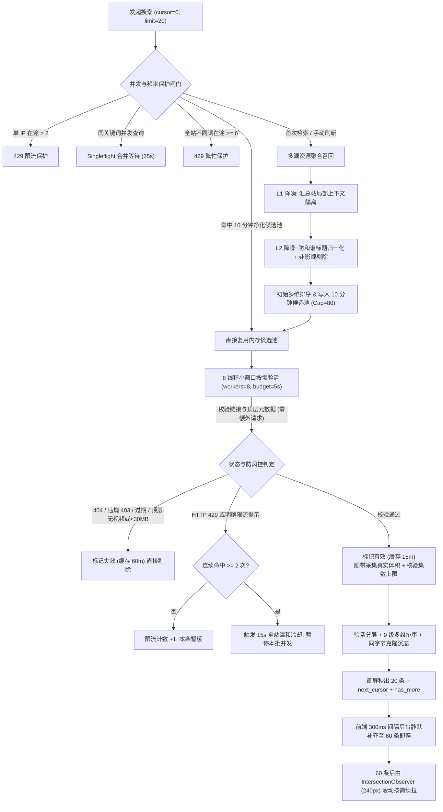
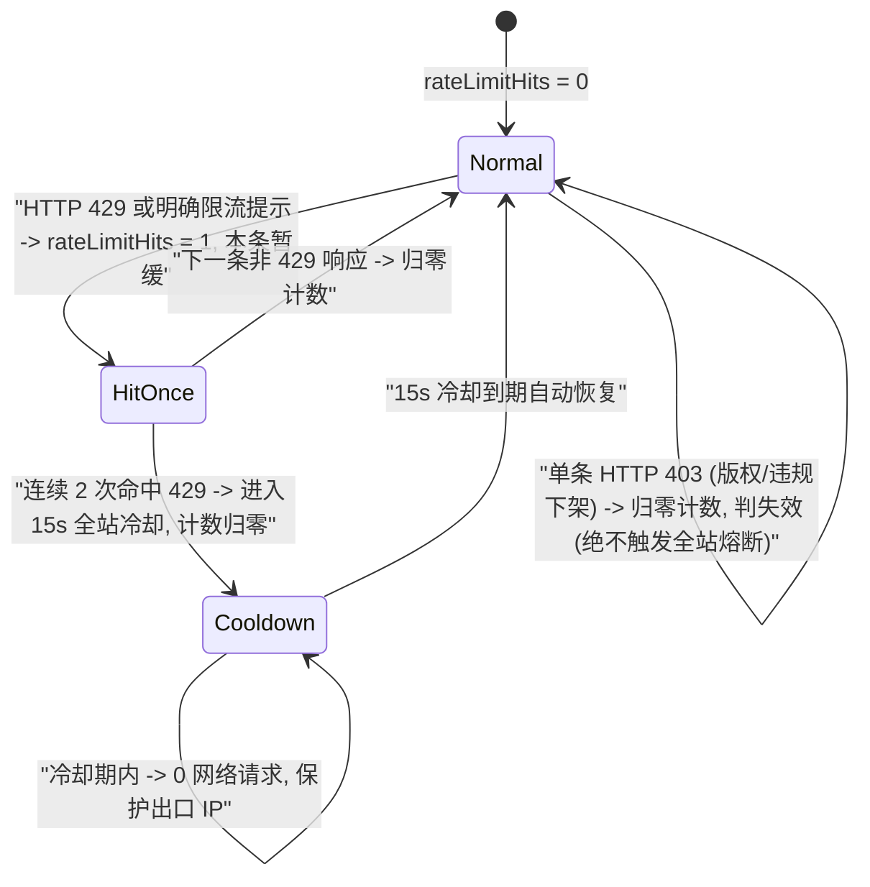
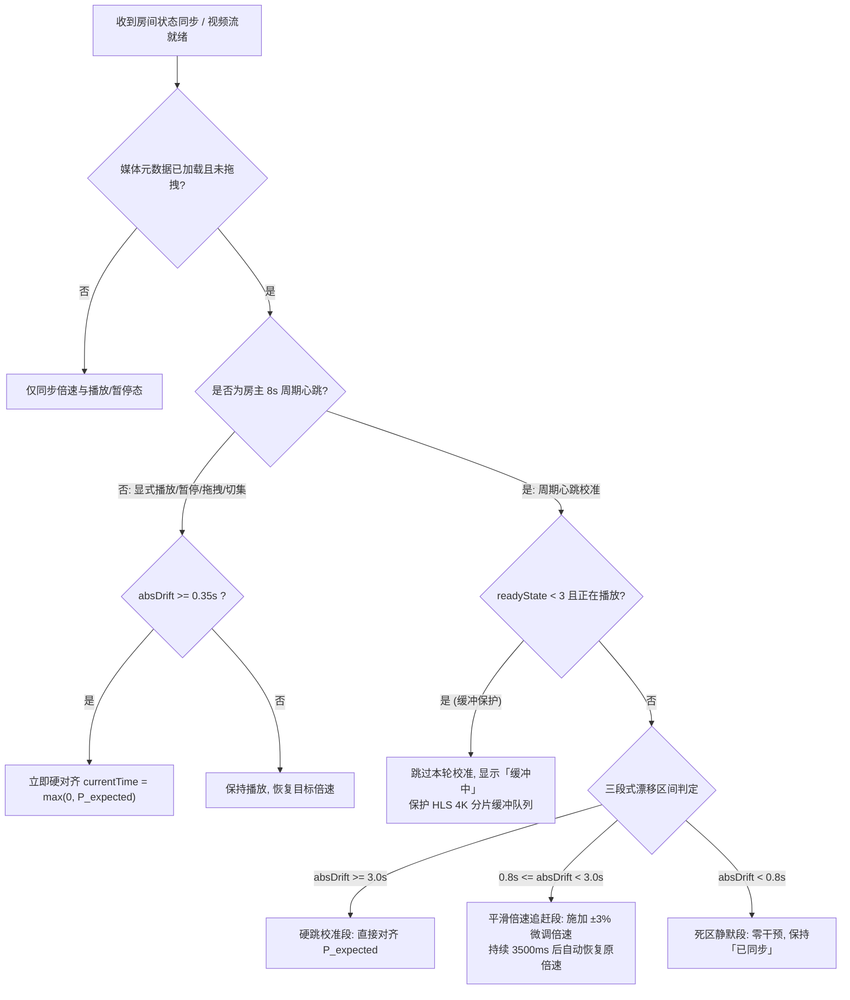
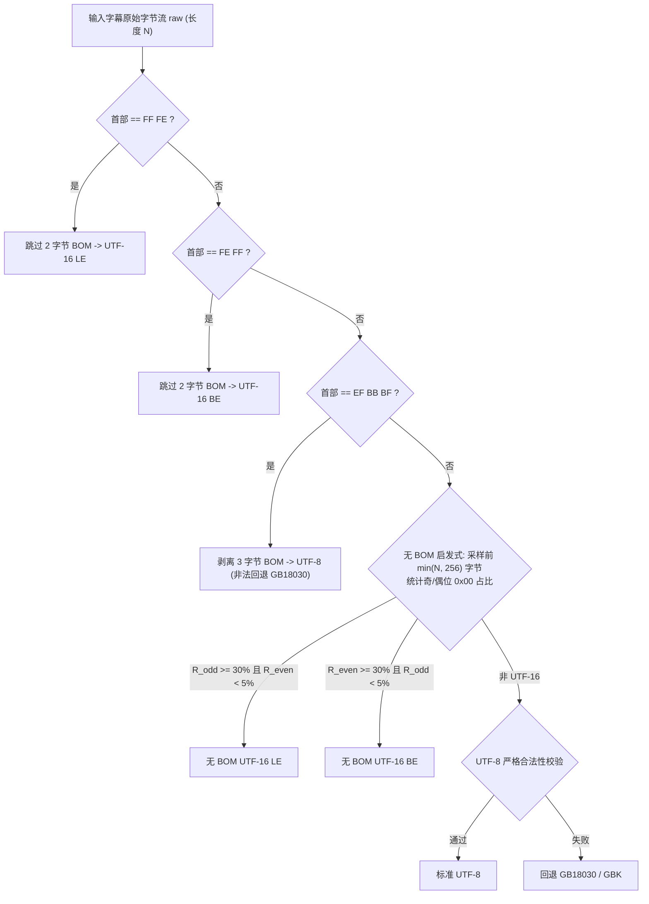

# 月映（MoonCast）核心算法与工程架构白皮书

> **核心理念**：月映（MoonCast）全站的影视资源降噪验活、多维画质排序、目录画质优选、自动追更避坑、共享放映室时间同步以及外挂字幕全链路解码关联，全部由 **100% 本地确定性工程算法** 驱动——**零外部 AI / LLM 推理依赖、零云端算力开销、毫秒级响应、完全可预测且可单元测试验证**。

---

## 总览：全站本地确定性算法矩阵

| 核心模块 | 关键工程算法 | 核心目标 |
| :--- | :--- | :--- |
| **一、搜片降噪、低并发验活与 9 级排序** | 单飞并发合并、双层上下文降噪、10 分钟净化候选池、8 线程分页验活、连续 2 次 429 熔断、9 级确定性排序与克隆沉底 | 秒出 20 条 100% 可用高码大片，零风控、踢出虚标/短剧/伪 60 帧广告 |
| **二、目录画质排序与自动追更避坑** | 杜比音轨隔离、4 档 8 级画质评分、同档单集均体积破平、纯字幕子目录提升、纯杜比兜底与双键去重 | 自动优选 `4K 60帧高码 / 4K HDR`，避开普通屏幕偏色的杜比视界 |
| **三、共享观影房间（「一起看」放映室）** | 30s 周期 NTP RTT 半程偏移校准、三段式漂移追赶、缓冲保护、显式单向指令与操作者回显忽略 | 多端跨网同步观影无跳帧、无回环震荡、弱网不打断 HLS 缓冲 |
| **四、外挂字幕编码探测与智能关联** | 前后端同构 6 阶段 BOM / NUL 启发式编码探测、ASS `[Events]` 与 `{\p1}` 绘图过滤、5 级匹配与中文字幕质量打分 | 彻底消除 UTF-16 / GBK 乱码与矢量坐标刷屏，全链路自动挂载最佳双语字幕 |

---

## 一、资源搜片降噪、低并发验活与 9 级多维排序算法

### 1.1 端到端搜索与渐进验活流程



### 1.2 双层降噪净化机制

1. **第一层（L1）：多链接汇总帖局部上下文隔离**
   - 当聚合来源为包含超过 2 条链接或泛汇总标题（如「影视更新」「今日资源」「每日汇总」）的合集帖时，**禁止**以整篇正文全局匹配关键词，避免「正文提到 A 剧，却把同帖里的 B/C/D 剧全部混进搜索结果」；
   - 仅当该链接对应的专属标题，或链接所在正文行及其紧邻前 1 行命中规范化关键词时才予保留。
2. **第二层（L2）：防和谐归一化与硬/软非影视信号分级**
   - **防和谐归一化**：统一剥离空白符与常见干扰分隔符（`| / · . _ - @ # & 【 】 [ ] ( ) （ ）`），使 `两|京|十|五|日`、`两.京.十.五.日` 无缝还原为 `两京十五日`；
   - **硬非影视拦截（`VideoTier = -1`）**：命中 `有声书 / 听书 / 广播剧 / 电子书 / 全N册 / epub / pdf / mp3 / flac` 等直接剔除；
   - **软非影视分级**：`原著 / 小说 / 全本 / 完本` 仅在标题不含明确视频信号（`4K / 1080P / HDR / REMUX / 蓝光 / 剧集` 等）时拦截，避免误杀标注「原著改编」或「典藏版」的高清影视；
   - **验活期空包/非视频兜底拦截**：在验活返回的顶层文件列表中，若满足以下任一条件立即判为无效并写入 60 分钟坏链缓存：

```math
(\neg\text{hasDir} \land \neg\text{hasVideo}) \;\lor\; (\neg\text{hasVideo} \land 0 \lt \text{ShareSize} \lt 30\text{ MB})
```

### 1.3 九级确定性排序链与评分公式

在验活状态（`已验活 > 需提取码 > 未确认`）分层内，按以下 9 级严格比较：

```math
\text{非短剧} \; \gt \; \text{明确视频层} \; \gt \; \text{精确主片名} \; \gt \; \text{多季合集} \; \gt \; \text{核验真实集数} \; \gt \; \text{画质+体积综合分} \; \gt \; \text{非纯杜比} \; \gt \; \text{单集/整片体积} \; \gt \; \text{更新时间}
```

#### 基础画质与时效评分表

| 维度 | 匹配特征（忽略大小写） | 分值 | 说明 |
| :--- | :--- | :---: | :--- |
| **分辨率** | `4K` / `2160P` / `UHD` | `+40` | 互斥取高 |
| | `1080P` | `+20` | — |
| **高帧率** | `60帧` / `60FPS` / `60Hz` | `+35` | 识别前先剥离网盘客户端 SVIP 推广文案，杜绝假 60 帧蹭分 |
| **高码率** | `高码` / `REMUX` / `蓝光` / `原盘` | `+22` | — |
| **动态范围** | `HDR` | `+18` | 识别前先剥离客户端 SVIP 推广文案 |
| **杜比视界** | 先剥离杜比音轨词（`杜比全景声 / Atmos / DDP`），再识别 `杜比视界 / DV / DoVi` | **`-20`**（纯杜比）<br>**`0`**（混有 60帧/高码/HDR） | 仅惩罚普通屏幕易绿紫偏色的纯杜比片源；杜比全景声音轨不扣分 |
| **集数/合集** | 完结集数（`全N集` / `共N集`） / 连载集数（`更N集` / `更新至N集`） | `+15` / `+12` | 连载优先于总集数，防 `更新至10集(共40集)` 误判 |
| | 电影多部合集（`1-4部` / `四部合集` / `三部曲`） | `+35` | 与剧集多季合集独立识别 |
| **时效加权** | 发布距今 `< 7 天` / `< 30 天` | `+20` / `+10` | 二选一 |

#### 真实体积客观加权与双版折半公式

验活阶段零额外请求采集分享总字节数 $`\text{ShareSize}`$（若元数据为 `0` 则累加顶层文件体积兜底）。对于标题包含 `DV&HDR`、`双版`、`多版`、`全版本` 的双版本剧集，将集数除数翻倍以准确估算单套单集体积：

```math
\text{divisor} = \begin{cases}
2 \times \text{EpisodeCount}, & \text{标题为双版/多版合集} \\
\text{EpisodeCount}, & \text{单版本剧集}
\end{cases}
```

- **剧集单集均体积**（`EpisodeCount > 0`，$`\text{perEpGB} = \dfrac{\text{ShareSize}}{\text{divisor} \times 1024^3}`$）：

```math
\Delta \text{Score}_{\text{size}} = \begin{cases}
+60, & \text{perEpGB} \ge 4.0\text{ GB} \\
+38, & 2.5 \le \text{perEpGB} \lt 4.0\text{ GB} \\
+15, & 1.5 \le \text{perEpGB} \lt 2.5\text{ GB} \\
0, & \text{perEpGB} \lt 1.5\text{ GB}
\end{cases}
```

  若同时满足 $`\text{EpisodeCount} \ge 5 \land \text{perEpGB} \lt 0.15\text{ GB}`$，自动判定为低码竖屏/微短剧，沉入最末档防止压过正剧。
- **电影整片体积**（`EpisodeCount == 0`，$`\text{totalGB} = \dfrac{\text{ShareSize}}{1024^3}`$）：

```math
\Delta \text{Score}_{\text{size}} = \begin{cases}
+60, & \text{totalGB} \ge 25.0\text{ GB} \\
+38, & 15.0 \le \text{totalGB} \lt 25.0\text{ GB} \\
+15, & 8.0 \le \text{totalGB} \lt 15.0\text{ GB} \\
0, & \text{totalGB} \lt 8.0\text{ GB}
\end{cases}
```

#### 七项实战防误排规则

1. **零额外请求识破「标题党虚标集数」**：
   利用分享顶层元数据自带的 `include_items`（单目录内直属条目数）与 `file_num` 核验实际文件数上限 $`\text{itemCap}`$：

```math
\text{itemCap} = \begin{cases}
\text{file\_num}\text{（或顶层列表长度）}, & \text{顶层全为平铺文件} \\
\text{List}[0].\text{include\_items}, & \text{顶层单一目录} \land \text{include\_items} \ge 5 \\
0, & \text{其他情况（如 2\textasciitilde 4 个画质子目录）}
\end{cases}
```

   对于非多季合集（`SeasonSpan < 2`），当 $`\text{itemCap} \gt 0 \land \text{EpisodeCount} \gt \text{itemCap}`$ 时，自动将虚标集数下修为真实上限、标签替换为 `实N集` 并重算单集均体积。
2. **多季合集严格优先于单季**：解析 `1-8季`、`S01-S08`、`全八季`、`庆余年1-2` 等多季跨度（排除 `第五季 全10集`、`01-03` 连载集号与电影 `1-4部`），多季合集严格排在单季之前且季数越多越靠前。
3. **精确主片名分级**：精确主片名（支持中文片名后接原版英文片名、年代、画质与语言修饰）严格优先于延伸/衍生/前传/番外/纪录片/整句夹杂标题（如 `庆余年之帝王业`、`泰坦尼克号：沉没之夜`、`龙之家族`、`剧场版` 与 `年番` 错配）。
4. **网盘会员推广文案剥离**：评分前正则剥离 `（SVIP会员可切换/超高清/60帧/HDR）`、`【SVIP会员可切换/...】` 等客户端推广词，防止普通压制版蹭高帧率分反超 70 GB 蓝光原盘。
5. **同分非纯杜比 + 真实体积破平**：同分时优先非纯杜比，再按单集均体积 / 整片总体积降序排列；前端卡片同步展示总体积与 `均 X.XX GB/集`。
6. **精确字节克隆沉底**：以验活后的 `ShareSize` 精确字节数为指纹，保留首个最优源在原位，其余同体积搬运克隆源顺移至当前批次尾部，确保前排呈现多样化片源。
7. **脏标题清洗**：反转义 HTML 实体（如 `&lrm;`）、剥离零宽字符与混入标题末尾的网盘链接。

### 1.4 违规 403 隔离与连续 2 次 429 熔断状态机



---

## 二、文件夹树画质排序与自动追更避坑算法

### 2.1 杜比音轨隔离与杜比视界识别

前后端采用完全一致的两步判定法，防止将优质多声道音轨误判为偏色杜比视界：
1. **先剥离杜比音轨词**：`杜比全景声 / 杜比音效 / 杜比数字 / 杜比声 / 杜比环绕 / Dolby Atmos / Digital / Audio / TrueHD / Surround`；
2. **再匹配杜比视界标识**：`杜比视界 / 杜比世界 / 杜比 / Dolby Vision / DV / DoVi`。

### 2.2 四档八级画质权重表与目录排序

| 优先级序 | 特征组合（非杜比视界前提下） | 权重分值 | 归类档位 |
| :---: | :--- | :---: | :--- |
| **1** | `4K` + `60Hz` + `高码 / REMUX / 蓝光 / 原盘` | **`400`** | 第 1 档：极品高帧高码 |
| **2** | `4K` + `60Hz` | **`300`** | 第 1 档：高帧 4K |
| **3** | `4K` + `高码` | **`250`** | 第 2 档：高码 4K |
| **4** | `4K` + `HDR` | **`230`** | 第 2 档：HDR 4K |
| **5** | `4K`（标准 4K） | **`220`** | 第 2 档：标准 4K |
| **6** | `1080P` | **`200`** | 第 3 档：高清 1080P |
| **7** | 其他未标注清晰度目录/文件 | **`150`** | 第 3 档：默认兜底 |
| **8** | 杜比视界（普通屏幕易绿紫偏色） | **`10`** | 第 4 档：自动沉底 |

- **目录树同档破平**：按画质权重降序 → 同档按**单集平均体积**（$`\text{totalSize} / \text{totalVideos}`$）降序 → 中文自然排序；纯字幕子目录（`Sub/`、`Subs/`、`字幕/`）自动向上提升至父目录字幕列表。
- **自动追更避坑、纯杜比兜底与原子整体换源**：根目录巡检时优先剔除杜比视界版本；仅当整份分享全部为纯杜比资源（非杜比候选集为空）时自动启用兜底，避免零集可追；落盘按 `QualityPriority` 降序 → 文件体积降序择优，并以「精确文件名 + `SxxExx` 季集键」双键防重；换源采用**原子换仓 + 后台异步清理**机制（先校验并转存新源至新仓，确认成功后再原子切换本地库并异步清空旧云盘目录，零阻塞且绝不丢片）。

---

## 三、共享观影房间（「一起看」放映室）时间同步与抗抖动算法

### 3.1 NTP RTT 半程延迟补偿与期望播放点公式

1. **周期时钟偏移校准（建连即校 + 每 30 秒复校）**：
   客户端发送 `sync_ping(client_ts_ms)`，服务端即时回传 `sync_pong(client_ts_ms, server_time_ms)`。客户端收到回复的本地时刻 $`t_{\text{now}}`$ 计算往返时延与时钟偏移（假设上下行对称，取 $`\text{RTT}/2`$ 补偿单程耗时）：

```math
\text{RTT} = \max\big(0,\; t_{\text{now}} - \text{client\_ts\_ms}\big)
```

```math
\text{clockOffset} = \text{round}\!\left(\text{server\_time\_ms} + \frac{\text{RTT}}{2} - t_{\text{now}}\right)
```

2. **任意时刻期望播放位置公式**：
   服务端每次状态变更记录基准点 $`\text{position\_sec}`$、倍速 $`r`$ 与服务端时间戳 $`\text{updated\_at\_ms}`$。客户端本地推算房间精确进度：

```math
P_{\text{expected}} = \begin{cases}
\text{position\_sec}, & \text{playing} = \text{false} \\
\text{position\_sec} + \max\!\left(0,\; \dfrac{t_{\text{now}} + \text{clockOffset} - \text{updated\_at\_ms}}{1000}\right) \times r, & \text{playing} = \text{true}
\end{cases}
```

### 3.2 三段式漂移校准与缓冲保护

定义本地有符号漂移 $`\text{signedDrift} = P_{\text{expected}} - v.\text{currentTime}`$，$`\text{absDrift} = |\text{signedDrift}|`$：



| 场景 / 区间 | 阈值条件 | 校准动作 | 体验价值 |
| :--- | :--- | :--- | :--- |
| **显式指令 / 入房首帧** | $`\text{absDrift} \ge 0.35\text{ s}`$ | 立即硬对齐 | 切集、拖拽、暂停瞬间精准一致 |
| **弱网缓冲保护** | 心跳帧且 `readyState < 3` | 跳过校准 | 避免 4K HLS 缓冲期间被心跳反复 seek 打断 |
| **死区静默段** | $`\text{absDrift} \lt 0.8\text{ s}`$ | 零干预 | 消除微抖动导致的音画撕裂 |
| **平滑倍速追赶段** | $`0.8\text{ s} \le \text{absDrift} \lt 3.0\text{ s}`$ | `±3%` 倍速维持 `3.5s` 自动复位 | **零额外分片下载、零跳帧、人耳无感拉齐** |
| **硬跳校准段** | $`\text{absDrift} \ge 3.0\text{ s}`$ | 直接跳至期望点 | 仅针对切后台/严重卡顿后的大跨度落后生效 |

### 3.3 单向指令与回显忽略（零 ping-pong 震荡）

- **单向发射边界**：仅显式用户 UI 交互（点击播放/暂停、拖拽进度、切倍速/切集/切画质）与房主 8 秒周期心跳可上报状态；原生 `<video>` DOM 回调与远端校准函数均不触发任何上行广播；
- **服务端原子定序**：互斥锁内鉴权、递增版本号并记录操作者 `updated_by_user_id` 后扇出广播；
- **操作者回显忽略**：发起人收到自己指令的服务端回显时直接忽略，彻底杜绝因 RTT 延迟导致的自我回拉与多端 ping-pong 震荡。

---

## 四、外挂字幕编码识别与全链路智能关联算法

### 4.1 前后端同构 6 阶段编码探测状态机



无 BOM UTF-16 奇偶位判定公式（采样长度 $`L = \min(N, 256)`$）：

```math
R_{\text{even}} = \frac{|\{i \in [0, L) : i \bmod 2 = 0 \land \text{raw}[i] = \texttt{0x00}\}|}{\text{evenCount}}, \qquad R_{\text{odd}} = \frac{|\{i \in [0, L) : i \bmod 2 = 1 \land \text{raw}[i] = \texttt{0x00}\}|}{\text{oddCount}}
```

### 4.2 ASS `[Events]` 节作用域与 `{\p1}` 矢量绘图滤除

- **严格节作用域**：仅在进入 `[Events]` 节后解析 `Format:` 列顺序与 `Dialogue:` 对话行，避免被 `[V4+ Styles]` 同名 `Format:` 行污染，并保留对话文本中的全部逗号；
- **矢量绘图行过滤**：匹配 `/\{[^}]*\\p[1-9](?![0-9])[^}]*\}/i` 并整行跳过，杜绝精校特效字幕中的贝塞尔绘图坐标在浏览器 WebVTT 中渲染成满屏乱码。

### 4.3 五级智能关联与中文字幕质量评分

- **五级降级关联顺序**：`1. 持久化偏好绑定` → `2. 文件名 Stem 精确包含` → `3. 剧集 SxxExx / 第N集 匹配` → `4. 去技术停用词后的核心片名前缀/词集相似度` → `5. 单部电影/单字幕兜底`。
- **语言与格式确定性加权**：始终遵循 **「简英/双语 > 简中 > 繁中」** 与 **「`.ass/.ssa` > `.srt` > `.vtt`」**，并在预览、收藏入库、续播与一起看房间中全链路持久化保持用户所选字幕。
